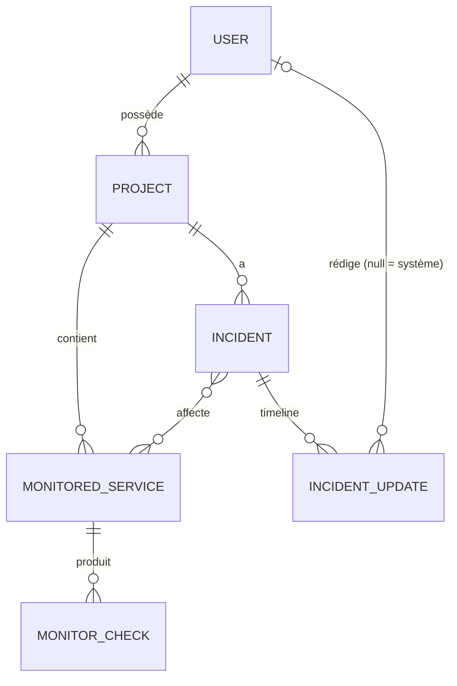
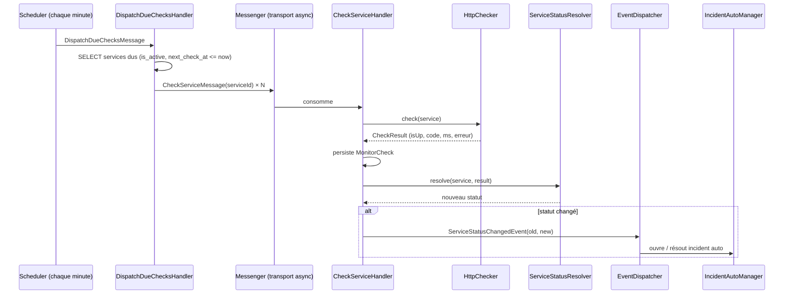

# Kabivox — Cahier des charges technique (MVP)

> Version 1.0 — 05/11/2026
> Stack : PHP 8.2+ · Symfony 7.4 LTS · Doctrine · PostgreSQL · Twig/Bootstrap · Messenger · Scheduler · PHPUnit · NelmioApiDoc (OpenAPI)

---

## 1. Périmètre du MVP

### 1.1 Vision

Une application SaaS permettant à un utilisateur de **surveiller automatiquement ses services web** (sites, API) et d'exposer une **page de statut publique** (type `status.monentreprise.com`) indiquant l'état de chaque service, son taux de disponibilité et l'historique des incidents.

### 1.2 Acteurs

| Acteur | Description |
|---|---|
| **Visiteur** | Anonyme. Consulte la page de statut publique d'un projet. |
| **Utilisateur** (`ROLE_USER`) | Inscrit. Crée ses projets, ses services surveillés, gère ses incidents. |
| **Administrateur plateforme** (`ROLE_ADMIN`) | Gère les utilisateurs et voit les statistiques globales de la plateforme. |
| **Système** | Worker Messenger + Scheduler : exécute les vérifications, détecte les pannes, ouvre/ferme les incidents automatiques. |

### 1.3 Fonctionnalités — IN (MVP)

| # | Module | Fonctionnalités |
|---|---|---|
| F1 | **Authentification** | Inscription, connexion, déconnexion, hash des mots de passe, protection CSRF, limitation des tentatives de connexion, jeton d'API personnel. |
| F2 | **Projets** | CRUD d'un projet (= une page de statut) avec un `slug` public unique. Un utilisateur peut avoir plusieurs projets. |
| F3 | **Services surveillés** | CRUD : nom, URL, méthode (GET/HEAD), code HTTP attendu, timeout, intervalle de vérification, seuil « dégradé » (ms), activation/pause, ordre d'affichage, visibilité publique. |
| F4 | **Monitoring automatique** | Vérification périodique de chaque service actif ; enregistrement du code HTTP, du temps de réponse et de l'erreur éventuelle. |
| F5 | **Détection de panne** | Calcul du statut d'un service, anti-faux positifs (N échecs consécutifs), ouverture et résolution **automatiques** d'incidents. |
| F6 | **Incidents** | Création manuelle, mises à jour successives (timeline), résolution, historique ; liaison à un ou plusieurs services. |
| F7 | **Statistiques** | Uptime 24 h / 7 j / 30 j / 90 j, temps de réponse moyen / p95, barre d'historique 90 jours. |
| F8 | **Page publique** | `/status/{slug}` : statut global, liste des services, barres d'uptime 90 jours, incidents en cours et historique. |
| F9 | **Dashboard** | Vue d'ensemble de ses projets, services, incidents ouverts, graphique des temps de réponse. Vue admin plateforme. |
| F10 | **API REST** | Endpoints publics (lecture du statut) et privés (gestion), documentés en OpenAPI / Swagger UI. |

### 1.4 Hors périmètre (V2+)

- Notifications (email, Slack, webhook) — *première fonctionnalité V2*.
- Équipes / membres multiples par projet.
- Maintenances planifiées.
- Domaines personnalisés pour les pages de statut.
- Vérifications multi-régions, TCP/ping/SSL/mots-clés.
- Abonnement / paiement.

---

## 2. Modèle de domaine

### 2.1 Entités

| Entité | Rôle |
|---|---|
| `User` | Compte utilisateur. |
| `Project` | Une page de statut, appartenant à un `User`. |
| `MonitoredService` | Un endpoint HTTP surveillé, appartenant à un `Project`. Porte l'**état courant** (statut, compteurs). |
| `MonitorCheck` | Résultat d'**une** vérification (table à fort volume, append-only). |
| `Incident` | Un incident (automatique ou manuel) d'un `Project`, lié à 1..n services. |
| `IncidentUpdate` | Une entrée de la timeline d'un incident (statut + message). |

> Ajout par rapport à l'architecture initiale : **`IncidentUpdate`**. Sans elle, impossible d'afficher la timeline « Investigating → Identified → Monitoring → Resolved » d'une vraie status page.

### 2.2 Énumérations (PHP 8.1 backed enums)

```php
enum ServiceStatus: string   { case Unknown = 'unknown'; case Operational = 'operational'; case Degraded = 'degraded'; case Down = 'down'; case Paused = 'paused'; }
enum IncidentStatus: string  { case Investigating = 'investigating'; case Identified = 'identified'; case Monitoring = 'monitoring'; case Resolved = 'resolved'; }
enum IncidentImpact: string  { case Minor = 'minor'; case Major = 'major'; case Critical = 'critical'; }
enum HttpMethod: string      { case Get = 'GET'; case Head = 'HEAD'; }
```

### 2.3 Diagramme entité-relation



### 2.4 Relations Doctrine

| Relation | Type | Cascade / suppression |
|---|---|---|
| `Project.owner` → `User` | ManyToOne | `ON DELETE CASCADE` |
| `MonitoredService.project` → `Project` | ManyToOne | `ON DELETE CASCADE` |
| `MonitorCheck.service` → `MonitoredService` | ManyToOne (unidirectionnelle) | `ON DELETE CASCADE` — **pas** de collection inverse (volume) |
| `Incident.project` → `Project` | ManyToOne | `ON DELETE CASCADE` |
| `Incident.affectedServices` ↔ `MonitoredService` | ManyToMany (table `incident_service`) | `ON DELETE CASCADE` sur la table de jointure |
| `IncidentUpdate.incident` → `Incident` | ManyToOne | `ON DELETE CASCADE`, `orphanRemoval` |
| `IncidentUpdate.author` → `User` | ManyToOne nullable | `ON DELETE SET NULL` |

---

## 3. Schéma SQL (PostgreSQL)

> Le schéma réel sera généré par les migrations Doctrine ; ce DDL sert de référence de conception.

```sql
CREATE TABLE app_user (
    id              SERIAL PRIMARY KEY,
    email           VARCHAR(180) NOT NULL UNIQUE,
    password        VARCHAR(255) NOT NULL,
    roles           JSON         NOT NULL DEFAULT '[]',
    display_name    VARCHAR(100) NOT NULL,
    api_token_hash  VARCHAR(64)  UNIQUE,            -- SHA-256 du jeton, jamais le jeton en clair
    is_active       BOOLEAN      NOT NULL DEFAULT TRUE,
    created_at      TIMESTAMP(0) WITH TIME ZONE NOT NULL
);

CREATE TABLE project (
    id           SERIAL PRIMARY KEY,
    owner_id     INT          NOT NULL REFERENCES app_user(id) ON DELETE CASCADE,
    name         VARCHAR(100) NOT NULL,
    slug         VARCHAR(100) NOT NULL UNIQUE,      -- ^[a-z0-9-]{3,100}$
    description  TEXT,
    is_public    BOOLEAN      NOT NULL DEFAULT TRUE,
    created_at   TIMESTAMP(0) WITH TIME ZONE NOT NULL
);
CREATE INDEX idx_project_owner ON project(owner_id);

CREATE TABLE monitored_service (
    id                     SERIAL PRIMARY KEY,
    project_id             INT          NOT NULL REFERENCES project(id) ON DELETE CASCADE,
    name                   VARCHAR(100) NOT NULL,
    url                    VARCHAR(2048) NOT NULL,
    http_method            VARCHAR(4)   NOT NULL DEFAULT 'GET',
    expected_status_code   SMALLINT     NOT NULL DEFAULT 200,
    timeout_seconds        SMALLINT     NOT NULL DEFAULT 10   CHECK (timeout_seconds BETWEEN 1 AND 30),
    check_interval_seconds INT          NOT NULL DEFAULT 300  CHECK (check_interval_seconds IN (60, 300, 600, 1800, 3600)),
    degraded_threshold_ms  INT          NOT NULL DEFAULT 2000,
    failure_threshold      SMALLINT     NOT NULL DEFAULT 3    CHECK (failure_threshold BETWEEN 1 AND 10),
    is_active              BOOLEAN      NOT NULL DEFAULT TRUE,
    is_public              BOOLEAN      NOT NULL DEFAULT TRUE,
    position               SMALLINT     NOT NULL DEFAULT 0,
    -- état courant (dénormalisé, mis à jour à chaque check)
    current_status         VARCHAR(20)  NOT NULL DEFAULT 'unknown',
    consecutive_failures   SMALLINT     NOT NULL DEFAULT 0,
    consecutive_successes  SMALLINT     NOT NULL DEFAULT 0,
    last_checked_at        TIMESTAMP(0) WITH TIME ZONE,
    next_check_at          TIMESTAMP(0) WITH TIME ZONE,
    created_at             TIMESTAMP(0) WITH TIME ZONE NOT NULL
);
CREATE INDEX idx_service_project  ON monitored_service(project_id);
CREATE INDEX idx_service_due      ON monitored_service(is_active, next_check_at);  -- requête "services à vérifier"

CREATE TABLE monitor_check (
    id                BIGSERIAL PRIMARY KEY,
    service_id        INT         NOT NULL REFERENCES monitored_service(id) ON DELETE CASCADE,
    checked_at        TIMESTAMP(0) WITH TIME ZONE NOT NULL,
    is_up             BOOLEAN     NOT NULL,
    status_code       SMALLINT,              -- NULL si timeout / erreur réseau
    response_time_ms  INT,                   -- NULL si pas de réponse
    error_message     VARCHAR(255)
);
CREATE INDEX idx_check_service_date ON monitor_check(service_id, checked_at DESC);  -- index clé : stats & graphiques

CREATE TABLE incident (
    id              SERIAL PRIMARY KEY,
    project_id      INT          NOT NULL REFERENCES project(id) ON DELETE CASCADE,
    title           VARCHAR(255) NOT NULL,
    status          VARCHAR(20)  NOT NULL DEFAULT 'investigating',
    impact          VARCHAR(20)  NOT NULL DEFAULT 'major',
    is_auto_created BOOLEAN      NOT NULL DEFAULT FALSE,
    started_at      TIMESTAMP(0) WITH TIME ZONE NOT NULL,
    resolved_at     TIMESTAMP(0) WITH TIME ZONE,
    created_at      TIMESTAMP(0) WITH TIME ZONE NOT NULL,
    CHECK ((status = 'resolved') = (resolved_at IS NOT NULL))
);
CREATE INDEX idx_incident_project_status ON incident(project_id, status);
CREATE INDEX idx_incident_project_start  ON incident(project_id, started_at DESC);

CREATE TABLE incident_service (
    incident_id  INT NOT NULL REFERENCES incident(id) ON DELETE CASCADE,
    service_id   INT NOT NULL REFERENCES monitored_service(id) ON DELETE CASCADE,
    PRIMARY KEY (incident_id, service_id)
);

CREATE TABLE incident_update (
    id           SERIAL PRIMARY KEY,
    incident_id  INT         NOT NULL REFERENCES incident(id) ON DELETE CASCADE,
    author_id    INT         REFERENCES app_user(id) ON DELETE SET NULL,  -- NULL = système
    status       VARCHAR(20) NOT NULL,
    message      TEXT        NOT NULL,
    created_at   TIMESTAMP(0) WITH TIME ZONE NOT NULL
);
CREATE INDEX idx_update_incident ON incident_update(incident_id, created_at);

-- + table messenger_messages (transport Doctrine de Symfony Messenger)
```

**Volumétrie estimée** : 20 services × 1 check / 5 min = 5 760 lignes/jour → ~520 000 lignes sur 90 jours. Rétention des checks bruts : **90 jours** (commande de purge). Pour la V2 : table d'agrégats journaliers `service_daily_stat`.

---

## 4. Règles métier

### 4.1 Exécution d'une vérification (RG-CHECK)

| ID | Règle |
|---|---|
| RG-CHECK-01 | Seuls les services `is_active = true` dont `next_check_at <= now()` (ou `NULL`) sont vérifiés. |
| RG-CHECK-02 | Après chaque check : `last_checked_at = now`, `next_check_at = now + check_interval_seconds`. |
| RG-CHECK-03 | Un check est **UP** si une réponse est reçue avant le timeout **et** `status_code == expected_status_code`. Sinon **DOWN** (mauvais code, timeout, DNS, TLS, connexion refusée). |
| RG-CHECK-04 | `response_time_ms` = temps total de la requête. `error_message` est renseigné (tronqué à 255 car.) en cas d'échec. |
| RG-CHECK-05 | Les redirections sont suivies (max 3). User-Agent identifiable : `KabivoxBot/1.0`. |
| RG-CHECK-06 | **Sécurité SSRF** : les URL pointant vers des IP privées / loopback / link-local (`127.0.0.0/8`, `10.0.0.0/8`, `172.16.0.0/12`, `192.168.0.0/16`, `169.254.0.0/16`, `::1`…) sont **refusées** à la validation **et** à l'exécution (`NoPrivateNetworkHttpClient`). Seuls `http` et `https` sont acceptés. |
| RG-CHECK-07 | Un même service ne peut pas être vérifié deux fois en parallèle (verrou `symfony/lock` par service). |

### 4.2 Calcul du statut d'un service (RG-STATUS)

| ID | Règle |
|---|---|
| RG-STATUS-01 | Check UP → `consecutive_failures = 0`, `consecutive_successes += 1`. Check DOWN → `consecutive_failures += 1`, `consecutive_successes = 0`. |
| RG-STATUS-02 | Si `consecutive_failures >= failure_threshold` → statut **`down`** (anti-faux positifs : une seule erreur ne déclenche pas de panne). |
| RG-STATUS-03 | Si `0 < consecutive_failures < failure_threshold` → le statut précédent est **conservé** (sauf `unknown` → `degraded`). |
| RG-STATUS-04 | Check UP avec `response_time_ms > degraded_threshold_ms` → **`degraded`**. |
| RG-STATUS-05 | Check UP avec temps normal → **`operational`**. Un service `down` ne repasse `operational` qu'après **2 succès consécutifs** (anti-flapping). |
| RG-STATUS-06 | Service mis en pause → **`paused`**, aucun check exécuté, exclu du calcul d'uptime pendant la pause. |
| RG-STATUS-07 | Service jamais vérifié → **`unknown`**. |

**Statut global d'un projet** (page publique) — le pire des services publics actifs :

| Condition | Statut global affiché |
|---|---|
| Tous `operational` | ✅ *Tous les systèmes sont opérationnels* |
| Au moins un `degraded`, aucun `down` | ⚠️ *Performances dégradées* |
| Au moins un `down` mais pas tous | 🟠 *Panne partielle* |
| Tous `down` | 🔴 *Panne majeure* |

### 4.3 Incidents automatiques (RG-INC-AUTO)

| ID | Règle |
|---|---|
| RG-INC-AUTO-01 | Transition d'un service vers `down` → si aucun incident **ouvert et automatique** n'affecte déjà ce service, création d'un `Incident` (`is_auto_created = true`, `status = investigating`, `impact = major`, titre : *« {service} est indisponible »*) + une `IncidentUpdate` système. |
| RG-INC-AUTO-02 | Transition `down` → `operational`/`degraded` → l'incident automatique ouvert de ce service passe à `resolved`, `resolved_at = now`, avec une `IncidentUpdate` système *« Le service est de nouveau accessible. Durée : X min »*. |
| RG-INC-AUTO-03 | Les incidents **manuels ne sont jamais** résolus automatiquement. |
| RG-INC-AUTO-04 | La détection est découplée via un événement de domaine `ServiceStatusChangedEvent` (le checker ne connaît pas le module incidents). |

### 4.4 Incidents manuels (RG-INC)

| ID | Règle |
|---|---|
| RG-INC-01 | Un incident a au moins un service affecté, appartenant au **même projet**. |
| RG-INC-02 | Workflow : `investigating → identified → monitoring → resolved`. Les étapes intermédiaires peuvent être sautées ; **un incident `resolved` est figé** (plus de mises à jour). |
| RG-INC-03 | Chaque changement de statut crée obligatoirement une `IncidentUpdate` avec un message (min. 5 caractères). |
| RG-INC-04 | La résolution renseigne `resolved_at` ; `resolved_at >= started_at`. |
| RG-INC-05 | La page publique affiche les incidents ouverts + les incidents résolus des **14 derniers jours** ; l'historique complet est paginé. |

### 4.5 Uptime et statistiques (RG-STATS)

| ID | Règle |
|---|---|
| RG-STATS-01 | `uptime(période) = nb checks UP / nb checks total × 100`, arrondi à 2 décimales. Un check `degraded` compte comme **UP**. |
| RG-STATS-02 | Aucune donnée sur la période → uptime `null` (affiché « Pas de données »), **jamais 100 %**. |
| RG-STATS-03 | Périodes disponibles : 24 h, 7 j, 30 j, 90 j. |
| RG-STATS-04 | Barre 90 jours : 1 segment par jour — vert ≥ 99,9 %, jaune ≥ 95 %, orange ≥ 80 %, rouge < 80 %, gris = pas de données. |
| RG-STATS-05 | Calculs faits en **SQL agrégé** (`GROUP BY date_trunc('day', checked_at)`), jamais en chargeant les entités en mémoire. |
| RG-STATS-06 | Temps de réponse : moyenne et p95 (`percentile_cont(0.95)`) sur les checks UP. |

### 4.6 Sécurité et permissions (RG-SEC)

| ID | Règle |
|---|---|
| RG-SEC-01 | Un utilisateur n'accède **qu'à ses propres** projets, services, incidents → `ProjectVoter` (`VIEW`, `EDIT`, `DELETE`). Accès refusé → **404** (et non 403) pour ne pas révéler l'existence de la ressource. |
| RG-SEC-02 | `ROLE_ADMIN` peut lister / désactiver des utilisateurs ; un utilisateur désactivé ne peut plus se connecter. |
| RG-SEC-03 | Mots de passe : min. 8 caractères, hash `auto` (bcrypt/argon2). |
| RG-SEC-04 | Connexion : `login_throttling` (5 tentatives / minute). |
| RG-SEC-05 | API privée : `Authorization: Bearer <token>` (authenticator `access_token` natif Symfony). Le jeton est affiché **une seule fois**, stocké hashé (SHA-256), régénérable. |
| RG-SEC-06 | Page publique : seulement si `project.is_public` ; seuls les services `is_public` sont affichés ; les URL surveillées ne sont **jamais** exposées publiquement. |
| RG-SEC-07 | Limites anti-abus : 5 projets et 20 services max par utilisateur (configurables) ; intervalle minimum 60 s. |
| RG-SEC-08 | API publique limitée par `RateLimiter` (60 req/min/IP). |

### 4.7 Limites par défaut (configurables via paramètres)

| Paramètre | Valeur |
|---|---|
| `app.max_projects_per_user` | 5 |
| `app.max_services_per_project` | 20 |
| `app.check_retention_days` | 90 |
| `app.recovery_threshold` | 2 |

---

## 5. Architecture technique

### 5.1 Arborescence

```
src/
├── Controller/
│   ├── Admin/          # Dashboard, CRUD (Twig)
│   ├── Api/            # API REST privée + publique (JSON)
│   ├── Public/         # Page de statut publique (Twig)
│   └── Security/       # Login, register
├── Dto/                # Objets d'entrée/sortie API (MapRequestPayload + Validator)
├── Entity/
├── Enum/
├── Event/              # ServiceStatusChangedEvent
├── EventSubscriber/    # → IncidentAutoManager
├── Form/
├── Message/            # CheckServiceMessage
├── MessageHandler/     # CheckServiceHandler
├── Repository/
├── Scheduler/          # MonitoringSchedule (RecurringMessage chaque minute)
├── Security/Voter/     # ProjectVoter
├── Service/
│   ├── Monitoring/     # HttpChecker, CheckResult (VO), ServiceStatusResolver
│   ├── Incident/       # IncidentManager, IncidentAutoManager
│   └── Status/         # UptimeCalculator, ProjectStatusResolver
├── Validator/          # PublicUrl (anti-SSRF)
└── Command/            # app:checks:run, app:checks:purge
```

### 5.2 Flux de monitoring



### 5.3 Contrainte d'hébergement gratuit (important)

Sur l'offre gratuite de Render, le service web **s'endort après ~15 min d'inactivité** et les *background workers* / *cron jobs* sont payants. Un worker Messenger permanent n'est donc pas possible à 0 DH.

**Solution retenue — double mode d'exécution** (le code métier est identique, seul le déclencheur change) :

| Mode | Déclencheur | Usage |
|---|---|---|
| **Worker** | `messenger:consume async scheduler_monitoring` | Local (Docker) et hébergement payant futur |
| **HTTP trigger** | Service de cron externe gratuit (ex. cron-job.org) → `POST /internal/cron/run-checks` toutes les 5 min, protégé par un secret (`X-Cron-Token`) ; exécution synchrone des checks dus | Render gratuit (réveille aussi l'application) |

**Base de données** : la PostgreSQL gratuite de Render expire (≈ 30 jours) → privilégier une PostgreSQL gratuite **Neon** ou **Supabase** (à revérifier au moment du déploiement, les offres évoluent).

### 5.4 Bundles / composants

| Besoin | Paquet |
|---|---|
| HTTP | `symfony/http-client` (+ `NoPrivateNetworkHttpClient`) |
| Asynchrone | `symfony/messenger` (transport Doctrine), `symfony/scheduler` |
| Verrous | `symfony/lock` |
| Limitation | `symfony/rate-limiter` |
| API doc | `nelmio/api-doc-bundle` |
| Front | Twig, Bootstrap 5 via AssetMapper, Chart.js (graphiques) |
| Tests | `phpunit`, `dama/doctrine-test-bundle`, `zenstruck/foundry` |
| Qualité | PHPStan (niveau 6+), PHP-CS-Fixer, GitHub Actions |

> **Choix assumé : API écrite à la main** (contrôleurs + DTO + `#[MapRequestPayload]` + Validator + Serializer) plutôt qu'API Platform — plus démonstratif en entretien sur la maîtrise de Symfony.

---

## 6. Endpoints

### 6.1 Pages web (Twig)

| Méthode | Route | Accès | Description |
|---|---|---|---|
| GET/POST | `/register`, `/login` | Anonyme | Inscription / connexion |
| GET | `/logout` | Connecté | Déconnexion |
| GET | `/status/{slug}` | Public | Page de statut |
| GET | `/status/{slug}/incidents` | Public | Historique paginé des incidents |
| GET | `/status/{slug}/incidents/{id}` | Public | Détail + timeline |
| GET | `/dashboard` | `ROLE_USER` | Vue d'ensemble |
| * | `/dashboard/projects/...` | `ROLE_USER` + Voter | CRUD projets |
| * | `/dashboard/projects/{id}/services/...` | `ROLE_USER` + Voter | CRUD services, détail avec graphiques |
| * | `/dashboard/projects/{id}/incidents/...` | `ROLE_USER` + Voter | CRUD incidents, ajout de mises à jour |
| GET/POST | `/dashboard/account` | `ROLE_USER` | Profil, (re)génération du jeton API |
| * | `/admin/users`, `/admin/stats` | `ROLE_ADMIN` | Gestion plateforme |

### 6.2 API publique — `/api/public` (sans authentification, rate-limitée)

| Méthode | Endpoint | Réponse |
|---|---|---|
| GET | `/api/public/status/{slug}` | Statut global + services (nom, statut, uptime 90 j) |
| GET | `/api/public/status/{slug}/incidents?page=1` | Incidents paginés |
| GET | `/api/public/status/{slug}/services/{id}/uptime?days=90` | Uptime journalier |

### 6.3 API privée — `/api/v1` (Bearer token)

| Méthode | Endpoint | Description | Codes |
|---|---|---|---|
| GET | `/api/v1/me` | Utilisateur courant | 200, 401 |
| GET | `/api/v1/projects` | Mes projets | 200 |
| POST | `/api/v1/projects` | Créer | 201, 422, 403 (quota) |
| GET | `/api/v1/projects/{id}` | Détail | 200, 404 |
| PATCH | `/api/v1/projects/{id}` | Modifier | 200, 422, 404 |
| DELETE | `/api/v1/projects/{id}` | Supprimer | 204, 404 |
| GET | `/api/v1/projects/{id}/services` | Services du projet | 200, 404 |
| POST | `/api/v1/projects/{id}/services` | Ajouter un service | 201, 422 |
| GET / PATCH / DELETE | `/api/v1/services/{id}` | Détail / modifier / supprimer | 200/204, 404, 422 |
| POST | `/api/v1/services/{id}/pause` · `/resume` | Pause / reprise | 200 |
| POST | `/api/v1/services/{id}/check` | Check immédiat (rate-limité) | 202 |
| GET | `/api/v1/services/{id}/checks?from=&to=&page=` | Historique des checks | 200 |
| GET | `/api/v1/services/{id}/stats?period=24h\|7d\|30d\|90d` | Uptime, temps moyen, p95 | 200, 400 |
| GET | `/api/v1/projects/{id}/incidents?status=open\|resolved` | Incidents | 200 |
| POST | `/api/v1/projects/{id}/incidents` | Créer un incident | 201, 422 |
| GET / PATCH | `/api/v1/incidents/{id}` | Détail / modifier (titre, impact, services) | 200, 404, 409 si résolu |
| POST | `/api/v1/incidents/{id}/updates` | Ajouter une mise à jour (statut + message) | 201, 409 si résolu, 422 |

### 6.4 Interne

| Méthode | Endpoint | Accès |
|---|---|---|
| POST | `/internal/cron/run-checks` | Header `X-Cron-Token` (comparaison `hash_equals`) |
| GET | `/health` | Public — vérifie la connexion BDD (utilisé par Render) |

### 6.5 Conventions

- JSON uniquement, dates **ISO 8601 UTC**.
- Pagination : `?page=1&limit=20` (max 100) → `{ "data": [...], "meta": { "page", "limit", "total" } }`.
- Erreurs au format **RFC 7807** (`application/problem+json`) ; erreurs de validation 422 avec la liste `violations[{ propertyPath, message }]`.
- Documentation : Swagger UI sur `/api/doc`, JSON sur `/api/doc.json`.

Exemple — `POST /api/v1/projects/1/services` :

```json
{
  "name": "API Production",
  "url": "https://api.example.com/health",
  "httpMethod": "GET",
  "expectedStatusCode": 200,
  "timeoutSeconds": 10,
  "checkIntervalSeconds": 300,
  "degradedThresholdMs": 2000,
  "failureThreshold": 3
}
```

---

## 7. Scénarios de tests

Objectif : **couverture ≥ 80 % sur `src/Service/`**, CI GitHub Actions verte à chaque push (PHPUnit + PHPStan + CS-Fixer, PostgreSQL en service Docker).

### 7.1 Tests unitaires (sans BDD, sans réseau)

| ID | Classe | Scénario |
|---|---|---|
| U-01 | `HttpChecker` | Réponse 200 attendue 200 → UP, temps mesuré (`MockHttpClient`) |
| U-02 | `HttpChecker` | Réponse 500 attendue 200 → DOWN, code 500 enregistré |
| U-03 | `HttpChecker` | Timeout → DOWN, `status_code = null`, message d'erreur |
| U-04 | `HttpChecker` | Erreur DNS / TLS → DOWN, message tronqué à 255 car. |
| U-05 | `ServiceStatusResolver` | 1 échec avec seuil 3 → statut inchangé |
| U-06 | `ServiceStatusResolver` | 3 échecs consécutifs avec seuil 3 → `down` |
| U-07 | `ServiceStatusResolver` | `down` + 1 succès → reste `down` ; + 2 succès → `operational` |
| U-08 | `ServiceStatusResolver` | UP mais 3 000 ms > seuil 2 000 ms → `degraded` |
| U-09 | `ProjectStatusResolver` | Combinaisons de statuts → statut global attendu (data provider) |
| U-10 | `UptimeCalculator` | 0 check → `null` ; 95 UP / 100 → 95,00 % ; degraded compté UP |
| U-11 | `IncidentAutoManager` | Passage à `down` → incident créé ; déjà un incident auto ouvert → pas de doublon |
| U-12 | `IncidentAutoManager` | Retour `operational` → incident auto résolu ; incident manuel non touché |
| U-13 | `IncidentManager` | Mise à jour d'un incident résolu → exception métier |
| U-14 | `PublicUrlValidator` | `http://127.0.0.1`, `http://169.254.169.254`, `ftp://…`, `http://10.0.0.1` → invalides ; `https://example.com` → valide |

### 7.2 Tests d'intégration (BDD de test)

| ID | Scénario |
|---|---|
| I-01 | `MonitoredServiceRepository::findDueForCheck()` ne retourne que les services actifs et dus |
| I-02 | `MonitorCheckRepository` : uptime journalier 90 j calculé en SQL correct sur un jeu de données Foundry |
| I-03 | `CheckServiceHandler` de bout en bout (HTTP mocké) : check persisté, statut mis à jour, incident créé après N échecs |
| I-04 | Commande `app:checks:purge` supprime uniquement les checks > 90 jours |

### 7.3 Tests fonctionnels (WebTestCase)

| ID | Scénario | Attendu |
|---|---|---|
| F-01 | Inscription puis connexion | Redirection vers `/dashboard` |
| F-02 | Accès `/dashboard` anonyme | Redirection `/login` |
| F-03 | Utilisateur A consulte le projet de B (web et API) | **404** |
| F-04 | `ROLE_USER` sur `/admin/users` | 403 |
| F-05 | API sans jeton / jeton invalide | 401 |
| F-06 | `POST /api/v1/projects` payload invalide | 422 + `violations` |
| F-07 | Création d'un 6ᵉ projet | 403 (quota) |
| F-08 | CRUD complet d'un service via l'API | 201 → 200 → 200 → 204 |
| F-09 | Service avec URL `http://localhost` | 422 |
| F-10 | `POST /api/v1/incidents/{id}/updates` sur incident résolu | 409 |
| F-11 | `/status/{slug}` | 200, services publics affichés, URL non exposées, services privés masqués |
| F-12 | `/status/{slug}` d'un projet non public / inexistant | 404 |
| F-13 | `/internal/cron/run-checks` sans token / mauvais token | 401 |
| F-14 | 6 tentatives de connexion échouées | Blocage temporaire |
| F-15 | `/api/doc.json` | 200, document OpenAPI valide |

### 7.4 Recette manuelle (avant mise en ligne)

- Surveiller un vrai site (ex. `https://example.com`) + une URL qui renvoie 500 (ex. `https://httpstat.us/500`) → vérifier l'ouverture et la résolution automatiques d'incidents.
- Vérifier la page publique sur mobile.
- Vérifier le déclenchement par le cron externe en production.

---

## 8. Planning détaillé (3 semaines)

| Semaine | Tâches | Livrable |
|---|---|---|
| **S1** — Fondations | Squelette Symfony 7.4, Docker (PostgreSQL), Git + CI ; entités + enums + migrations ; fixtures Foundry ; inscription / connexion ; `ProjectVoter` ; CRUD projets & services (Twig) ; validateur anti-SSRF | Un utilisateur peut créer ses projets et services |
| **S2** — Moteur | `HttpChecker`, Messenger + Scheduler, `ServiceStatusResolver`, `MonitorCheck` ; événement + incidents automatiques ; incidents manuels + timeline ; API REST + DTO + Nelmio ; jeton API ; commande de purge ; endpoint cron | Le monitoring tourne, l'API est documentée |
| **S3** — Produit | `UptimeCalculator` (SQL) ; dashboard + Chart.js ; page publique + barres 90 j ; admin plateforme ; rate limiting ; tests (objectif §7) ; PHPStan ; Dockerfile Render ; BDD Neon ; cron externe ; README avec captures et lien démo | Démo en ligne + dépôt GitHub présentable |

---

## 9. Définition de « terminé » (MVP)

- [ ] Tous les scénarios de tests §7.1–7.3 implémentés et verts en CI.
- [ ] PHPStan niveau 6 sans erreur.
- [ ] Démo en ligne avec un compte de démonstration (données réalistes).
- [ ] Swagger UI accessible en ligne.
- [ ] README : présentation, captures, schéma d'architecture, choix techniques, instructions d'installation en une commande (`docker compose up`).
